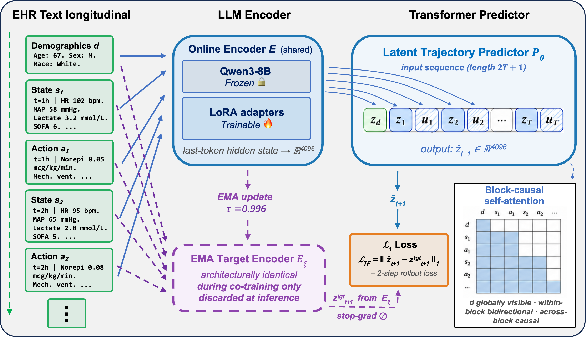

<h1 align="center">Clin-JEPA</h1>

<p align="center"><b>A Multi-Phase Co-Training Framework for Joint-Embedding Predictive Pretraining on EHR Patient Trajectories</b></p>

<p align="center">
  <a href="https://opensource.org/licenses/MIT"></a>
  <a href="https://www.python.org/downloads/"></a>
</p>

> [!IMPORTANT]
> ### 📢 News
> - **[Sep 2026] ✨ Full pipeline released.** This repository now contains the complete end-to-end pipeline behind the paper, from raw MIMIC-IV to every figure and table: data processing, training of all six models, latent rollout, and the three evaluations (rollout stability, latent geometry, and the 34-task downstream benchmark). Each stage has a step-by-step guide in [`docs/`](docs).
> - **[Sep 2026] 🤗 Open-source model release.** The pretrained Clin-JEPA backbone, the co-trained encoder adapters together with the latent trajectory predictor, is being prepared for public release with loading code. Details will be announced here.

> **Note:** This repository accompanies a paper currently under double-blind review. Author, citation, and funding information have been omitted from this version and will be added once review concludes.

Clin-JEPA is a latent world model for intensive-care patient trajectories. An LLM encoder reads each hour of the record as text, observations and interventions separately, so no feature engineering or vocabulary mapping is needed. An action-conditioned Transformer predictor rolls the patient state forward in the encoder's latent space under the recorded interventions, and is kept at inference.

Instead of freezing the encoder before the predictor is trained, Clin-JEPA trains the two together under one latent-prediction objective. A five-phase curriculum (predictor warmup, co-training, EMA target alignment, hard sync, predictor finalization) keeps this co-training stable: the representation does not collapse and the predictor's target space does not drift. In the paper's experiments the encoder is Qwen3-8B with LoRA adapters and the predictor has 92M parameters; [`docs/architecture.md`](docs/architecture.md) describes the components, the curriculum and the path of each of the six models through the stages.

<p align="center">
  
</p>

## What is here

The code that takes MIMIC-IV v3.1 to every figure and table of the paper's experiments:

- the data pipeline: cohort, hourly observations and interventions, patient-level split, text trajectories;
- training of the six models the paper compares: Clin-JEPA, the V-JEPA 2-AC style and SFT baselines, the two curriculum ablations, and the variant with a predictor trained separately on the frozen Clin-JEPA encoder;
- one latent rollout per model, shared by all evaluations;
- the three evaluations: stability of the co-trained encoder and predictor, latent geometry, and 34 downstream tasks on three benchmarks against Ridge, LightGBM, LSTM, TCN and CLMBR-T-base.

## Getting started

```bash
git clone <repository-url> && cd Clin-JEPA
pip install -r requirements.txt && pip install -e .
pip install flash-attn==2.8.3 --no-build-isolation   # on a GPU node with the CUDA toolkit
cp .env.example .env                                 # paths to MIMIC-IV, the outputs and the Hugging Face cache
```

Then follow the guides in order, starting with [setup](docs/00-setup.md): data access, environment variables and hardware. `pip install -e ".[dev]" && pytest` runs the unit tests on synthetic data in a few seconds.

Compute: the data stage runs on CPU nodes in under an hour as ten-task arrays. Clin-JEPA pretraining took about 430 GPU-hours on 8 H200 GPUs, encoder SFT about 40 and the V-JEPA 2-AC style refinement about 50. An embedding cache takes about 22 GPU-hours and 96 GB per encoder. The evaluations run on CPU nodes and a single GPU.

## Pipeline

Each stage has a guide in [`docs/`](docs) with its inputs, commands, outputs and resources.

| stage | guide                               | code                   | produces                                                                           |
| ----- | ----------------------------------- | ---------------------- | ---------------------------------------------------------------------------------- |
| 00    | [setup](docs/00-setup.md)           |                        | environment, data access, paths                                                    |
| 01    | [data](docs/01-data.md)             | `clin_jepa.data`       | cohort, hourly bins, split, trajectory shards, the feature table of Appendix A     |
| 02    | [encoders](docs/02-encoders.md)     | `clin_jepa.training`   | encoder SFT, Clin-JEPA curriculum, V-JEPA 2-AC style refinement, the two ablations |
| 03    | [embeddings](docs/03-embeddings.md) | `clin_jepa.encode`     | one embedding cache per encoder                                                    |
| 04    | [predictors](docs/04-predictors.md) | `clin_jepa.training`   | predictors on frozen encoders                                                      |
| 05    | [rollout](docs/05-rollout.md)       | `clin_jepa.rollout`    | pooled rollout blocks and per-step errors                                          |
| 06    | [stability](docs/06-stability.md)   | `clin_jepa.stability`  | Fig. 2, Table 2, Appendices C–D                                                    |
| 07    | [geometry](docs/07-geometry.md)     | `clin_jepa.geometry`   | Fig. 3, Table 3, Appendix E                                                        |
| 08    | [downstream](docs/08-downstream.md) | `clin_jepa.downstream` | Fig. 4, Table 4, the per-task tables                                               |

## Layout

```
clin_jepa/
  data/          MIMIC-IV to text trajectories
  model/         action-conditioned predictor, masked-prediction head
  training/      encoder SFT, curriculum, V-JEPA 2-AC style refinement, predictors on frozen encoders
  encode.py      embedding caches
  rollout.py     latent rollout
  stability/     rollout drift, rank diagnostics, report
  geometry/      cohorts, native-space statistics, UMAP view, report
  downstream/    labels, features, read-outs, baselines, bootstrap, report, clmbr/
configs/         one YAML per stage and per training run
docs/            numbered guides
slurm/           job templates
tests/           unit tests on synthetic data
```

## Data

Experiments use MIMIC-IV v3.1 ([Johnson et al., 2023](https://physionet.org/content/mimiciv/3.1/)), available from PhysioNet under credentialed access. No patient data, derived features or model outputs are distributed with this repository.

## Citation

Citation information has been omitted while this work is under double-blind review, and will be added once review concludes.

## License

This code is released under the [MIT License](LICENSE). MIMIC-IV data is governed separately by the PhysioNet Credentialed Health Data License.

## Acknowledgments

We thank the MIMIC-IV team at the MIT Laboratory for Computational Physiology and Beth Israel Deaconess Medical Center for making the dataset publicly available. Funding acknowledgments have been omitted for anonymity and will be added once review concludes.
