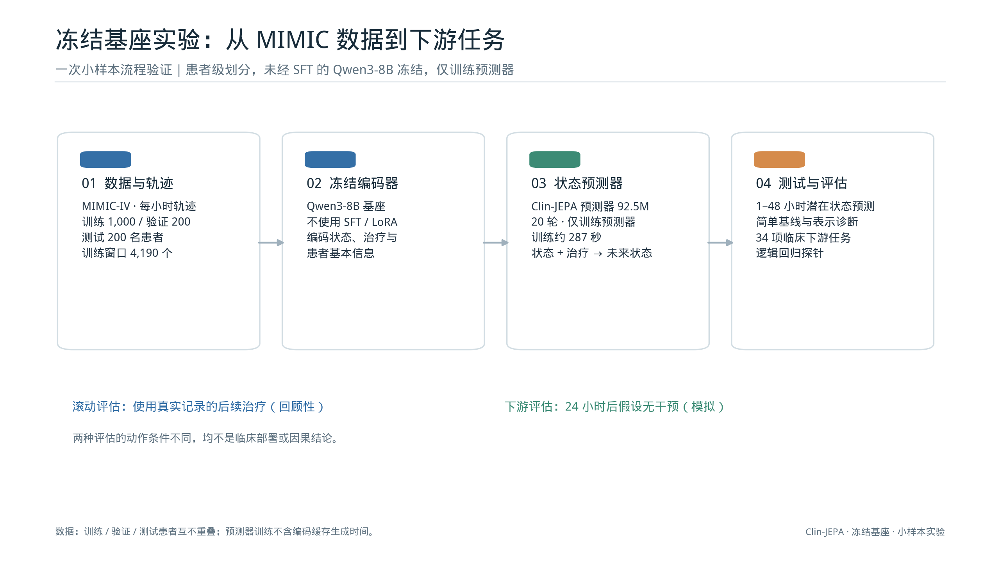
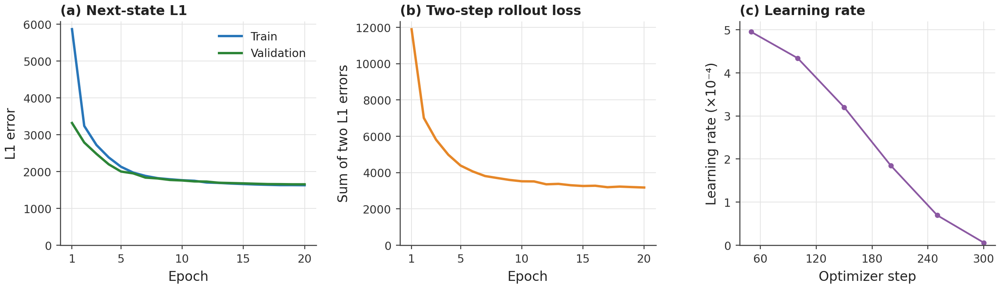
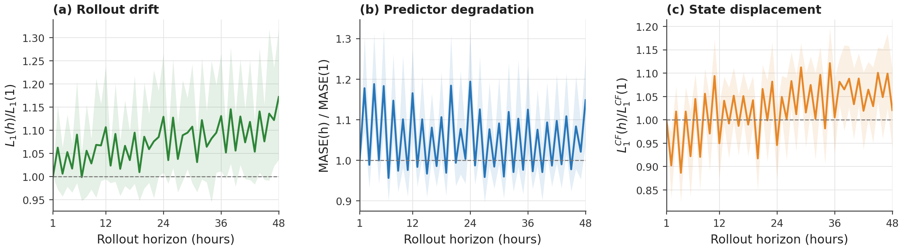
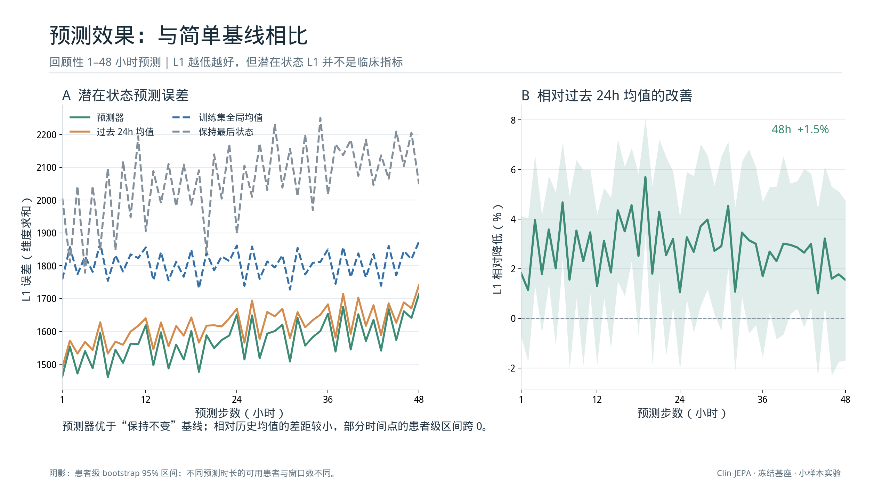
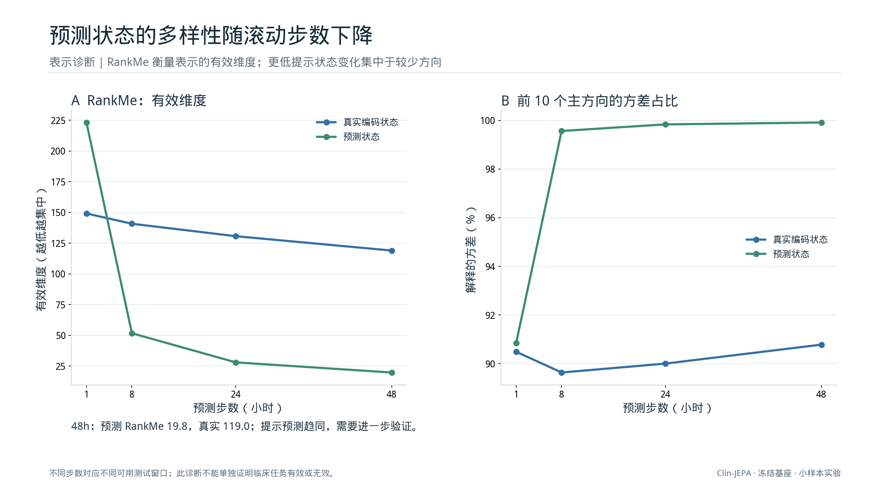
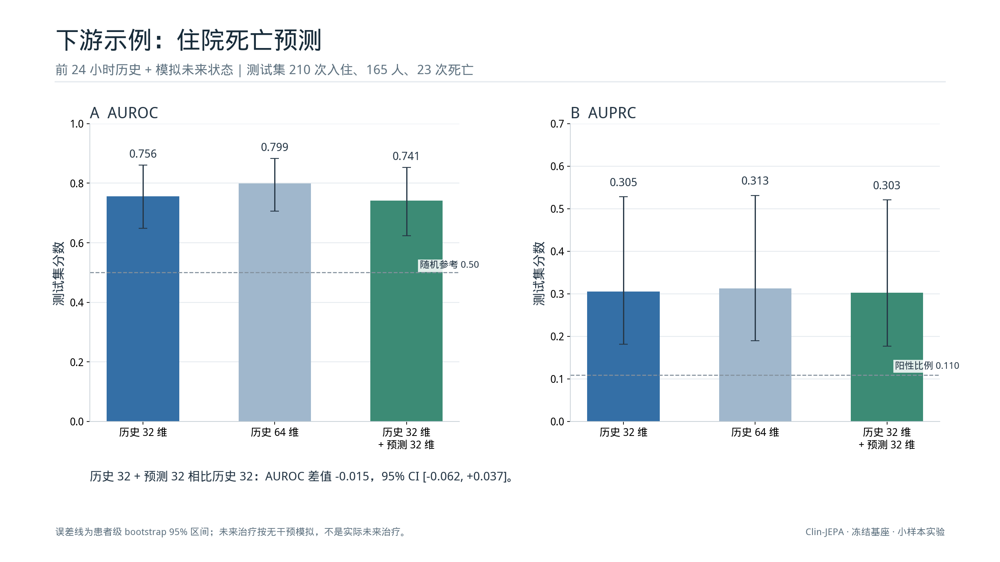
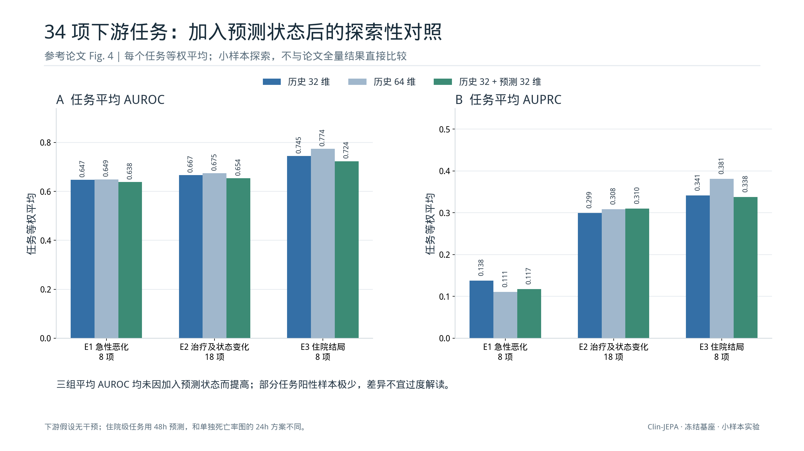

# 冻结 Qwen3 基座：小样本实验可视化

新增的预测状态增益对照见 [预测状态增益实验](17-predictor-increment-results.md)。

这组图展示已经完成的一次流程验证：MIMIC-IV 轨迹、冻结 Qwen3-8B 编码、Clin-JEPA 状态预测器训练、滚动预测和临床下游评估。**不是论文原模型或全量结果的复现**：我们的编码器没有经过 SFT，预测器是小样本训练，下游使用 PCA 与逻辑回归。图表参照既有组会报告的白底论文图表风格，图 3、图 7 参考论文 Fig. 2、Fig. 4 的多面板形式；未混入论文数值。

图为可直接插入 PPT 的独立图表，标题和说明可在 PPT 中自行排版。点击每张图下面的 PNG 或 SVG 链接下载高清版本。图中的数值和置信区间均来自本次实验的汇总结果。绘图脚本的流程示意和部分文字针对本次固定方案编写，换实验后需要重新核对并更新。

## 1. 从数据到评估



[PNG](assets/frozen-base-figures/01_pipeline.png) · [SVG](assets/frozen-base-figures/01_pipeline.svg)

从患者级划分抽样，训练、验证、测试分别为 1,000、200、200 名患者。冻结未经 SFT 的 Qwen3-8B，仅训练 92.5M 参数的预测器。预测器训练约 287 秒，不包括数据预处理和编码缓存生成。

## 2. 预测器训练曲线



[PNG](assets/frozen-base-figures/02_training.png) · [SVG](assets/frozen-base-figures/02_training.svg)

训练共 20 轮，单步验证 L1 从 3,317.56 降至 1,653.03；L1 为状态向量 4,096 维绝对误差之和。单步图采用真实历史状态作为输入（teacher forcing）；两步图显示训练日志中的两步误差之和，**不能直接与单步验证 L1 比较**。学习率只展示日志中每 50 步记录的值，连线不代表记录了中间每一步。

## 3. 滚动预测随时间的变化



[PNG](assets/frozen-base-figures/03_rollout_stability.png) · [SVG](assets/frozen-base-figures/03_rollout_stability.svg)

三个量分别以 1h 值为 1：预测器 L1、MASE（预测器 L1 除以保持最后状态不变的 L1）以及保持不变基线的 L1。48h 分别为 1.17、1.15、1.02。阴影是 2,000 次按患者重采样的 95% bootstrap 区间，窗口按原评估方式加权；一个患者可贡献多个重叠窗口。

不同预测时长的可用患者不同：1h 贡献 162 人、702 窗口，48h 贡献 64 人、573 窗口。因此曲线同时受预测步数和样本构成变化影响，并非严格的同一患者纵向比较。评估使用**真实记录的后续治疗**作为条件，属于回顾性实验。

## 4. 与简单基线比较



[PNG](assets/frozen-base-figures/04_prediction_baselines.png) · [SVG](assets/frozen-base-figures/04_prediction_baselines.svg)

48h 时预测器 / 保持最后状态 / 过去 24h 均值的 L1 分别为 1,714.25 / 2,048.10 / 1,741.18。预测器的点估计优于保持最后状态，相对过去 24h 均值的改善约为 1.5%；患者级 95% 区间跨越零，现阶段不能确定其相对于历史均值的稳定优势。L1 是表示空间误差，不是临床准确率。

## 5. 预测状态的表示诊断



[PNG](assets/frozen-base-figures/05_representation.png) · [SVG](assets/frozen-base-figures/05_representation.svg)

48h 时预测状态的 RankMe 为 19.8，真实编码状态为 119.0；前 10 个主方向的方差占比分别为 99.91% 和 90.78%。这**提示**预测状态可能趋同、变化集中在较少方向，需后续用更多数据和对照验证；这些统计量本身无法判断临床效果。不同时间点的患者与窗口组成可能不同。

## 6. 住院死亡预测



[PNG](assets/frozen-base-figures/06_mortality.png) · [SVG](assets/frozen-base-figures/06_mortality.svg)

历史 32 维 / 历史 64 维 / 历史 32 维加预测未来 32 维，AUROC 分别为 0.756 / 0.799 / 0.741，AUPRC 分别为 0.305 / 0.313 / 0.303。加入预测状态相对历史 32 的 AUROC 差值为 −0.015，配对患者级 bootstrap 95% CI 为 [−0.062, +0.037]，不能断言有益或有害。

测试包含 210 次入住、165 名患者、23 次死亡。该实验以前 24 小时为历史，之后假设无干预并生成 24 小时未来状态；这是人工条件，不能解读为真实治疗预测或因果反事实。各柱误差线为单模型患者级 95% 区间；“差值区间”来自配对重采样，不能通过比较两根误差线推算。

## 7. 34 项下游任务概览



[PNG](assets/frozen-base-figures/07_downstream.png) · [SVG](assets/frozen-base-figures/07_downstream.svg)

按每项任务等权求组内平均，加入预测状态后 E1、E2、E3 三组的平均 AUROC 点估计均低于历史 32 维。E2 平均 AUPRC 点估计略有提高。不同任务的阳性率和样本量差异很大，有些任务测试集中只有极少数阳性患者；这里没有给组平均构造置信区间，不能将分组均值当成显著性检验。

该 34 项协议的住院级任务使用 **48 小时**模拟未来特征，和图 6 的单项死亡实验使用 24 小时不同。未来动作同样是假设无干预。完整单项任务和不确定性见 [34 项下游结果](13-all-downstream-results.md)，可直接用于 PPT 的分组表格见 [34 项下游任务表](16-34-task-tables.md)。

## 生成与数据来源

服务器上的实验目录：`/media/cuichang/liuhao/clin-jepa/sample_3h/`。训练日志、模型输出和患者级数据留在服务器；Git 仓库只包含可公开的汇总数值、绘图代码和图，不包含患者级数据或权重。

```bash
cd /home/cuichang/liuhao/Clin-JEPA
set -a; source .env; set +a
SAMPLE=/media/cuichang/liuhao/clin-jepa/sample_3h
OMP_NUM_THREADS=4 OPENBLAS_NUM_THREADS=4 "$CLIN_JEPA_PYTHON" -m scripts.prepare_figure_data \
  --experiment "$SAMPLE" --output docs/assets/frozen-base-figures/figure_data.json
"$CLIN_JEPA_PYTHON" -m scripts.create_experiment_figures \
  --data docs/assets/frozen-base-figures/figure_data.json --output docs/assets/frozen-base-figures
```

汇总生成脚本读取 `logs/train_predictor.log`、`output/predictor_qwen3_base/training_meta.json`、`diagnostics/` 下的 rollout / baseline / rank 结果，以及 `clinical_data/` 下两个下游评估的结果；绘图脚本只读取仓库里的 [汇总 JSON](assets/frozen-base-figures/figure_data.json)。图形输出使用 Matplotlib 与服务器的文泉驿微米黑字体。详细的实验协议和限制另见 [小样本预测结果](10-sampled-frozen-base-results.md) 与 [死亡率对照](12-mortality-probe.md)。
