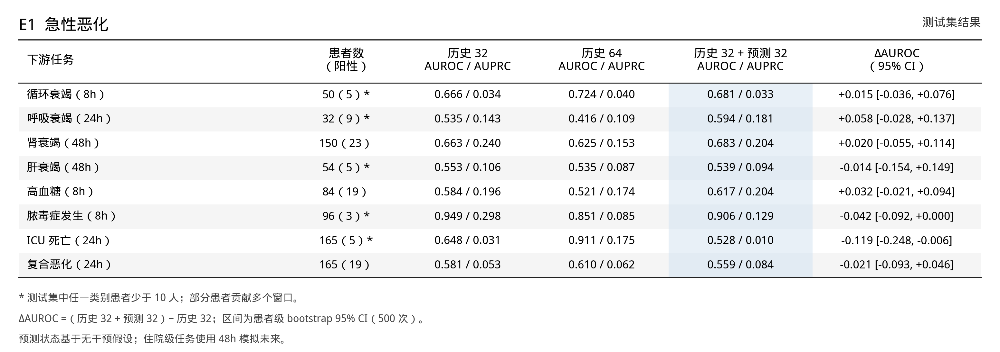
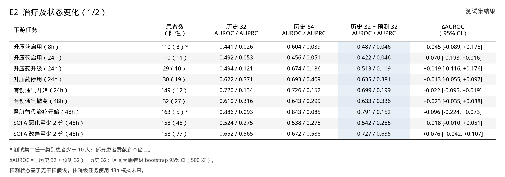
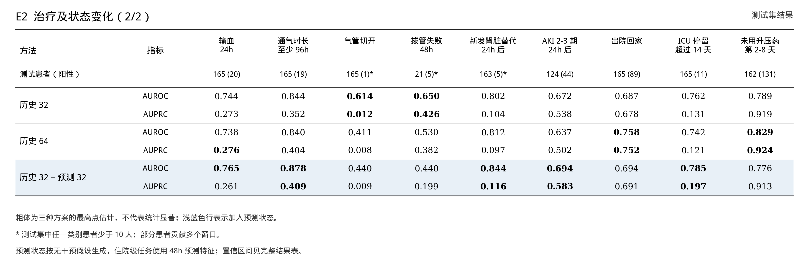
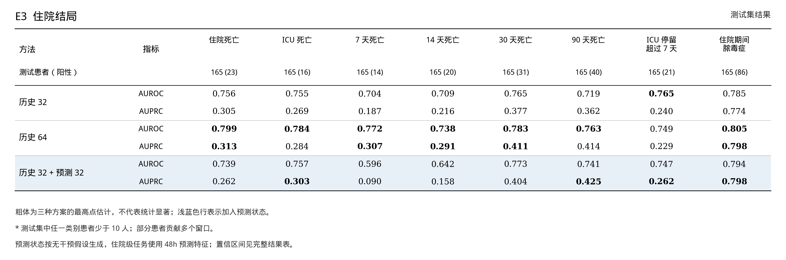

# 冻结基座实验：34 项下游任务

新增的历史 64、历史 64 + 预测 32 和历史 64 + 保持 32 对照见 [预测状态增益实验](17-predictor-increment-results.md)。

四张表展开 E1、E2、E3 三组任务：方法在行、任务在列，AUROC 和 AUPRC 分行展示，可直接插入组会 PPT。AUPRC 使用 average precision。浅蓝色行表示加入预测状态，粗体表示该任务在三种方案中的最高点估计，不代表统计显著。

- **历史 32**：历史状态经 PCA 后保留 32 维。
- **历史 64**：历史状态保留 64 维，用作容量对照。
- **历史 32 + 预测 32**：历史与预测的未来状态各保留 32 维。
- **ΔAUROC**：加入预测状态的方案减历史 32，配对患者级 bootstrap 95% 置信区间见 [完整文字表](13-all-downstream-results.md)，采用 500 次重采样。

测试患者数后面的括号为阳性患者数；`*` 表示测试集阳性或阴性患者少于 10 人。部分任务按窗口评估，一个患者可贡献多个窗口，且同一患者的不同窗口可属于不同类别。区间和比较均为小样本探索，34 项任务构成多重比较，不应仅凭单个区间判断模型有效。

预测未来时，24 小时之后假设无干预。这是人为设定，并非真实后续治疗或已验证的因果反事实。住院级任务在这组表中使用 **48 小时**预测特征；先前单独的住院死亡实验使用 24 小时预测特征，因此对应的预测组数值不同。

## E1：急性恶化



[PNG](assets/frozen-base-figures/08_tasks_e1.png) · [SVG](assets/frozen-base-figures/08_tasks_e1.svg)

## E2：治疗及状态变化（1/2）



[PNG](assets/frozen-base-figures/09_tasks_e2_a.png) · [SVG](assets/frozen-base-figures/09_tasks_e2_a.svg)

## E2：治疗及状态变化（2/2）



[PNG](assets/frozen-base-figures/10_tasks_e2_b.png) · [SVG](assets/frozen-base-figures/10_tasks_e2_b.svg)

## E3：住院结局



[PNG](assets/frozen-base-figures/11_tasks_e3.png) · [SVG](assets/frozen-base-figures/11_tasks_e3.svg)

可复制的完整文字表及实验细节见 [34 项下游任务结果](13-all-downstream-results.md)；实验过程和前面的图见 [小样本实验可视化](15-frozen-base-figures.md)。

## 重新生成

图表由 [汇总数据](assets/frozen-base-figures/figure_data.json) 生成，不包含患者级记录或模型权重：

```bash
cd /home/cuichang/liuhao/Clin-JEPA
set -a; source .env; set +a
"$CLIN_JEPA_PYTHON" -m scripts.create_task_tables \
  --data docs/assets/frozen-base-figures/figure_data.json \
  --output docs/assets/frozen-base-figures
```
