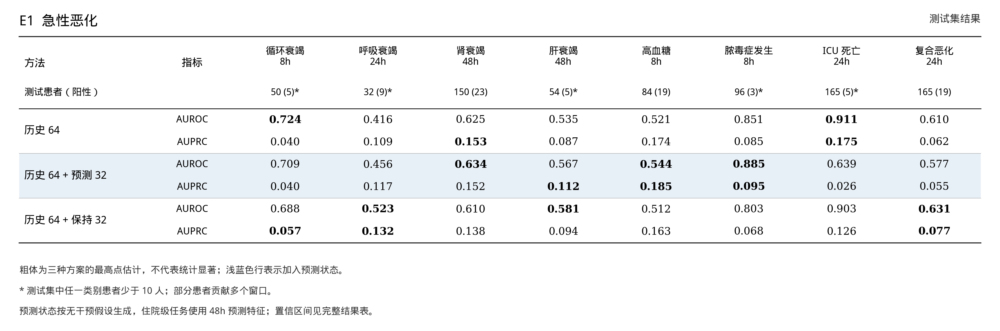
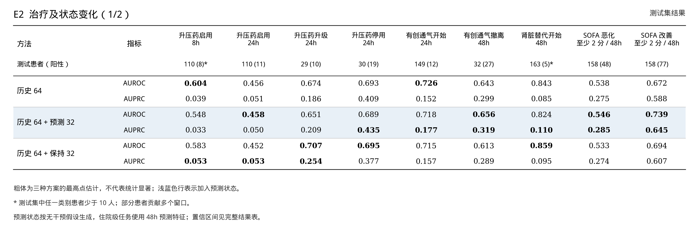
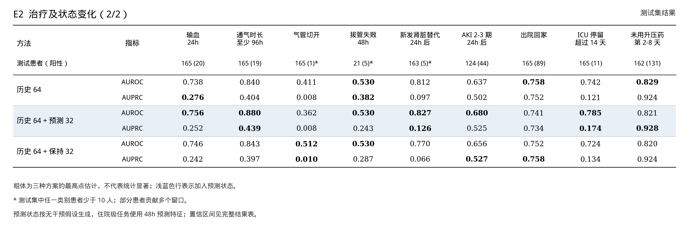
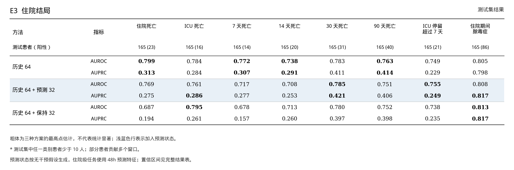

# 冻结基座实验：预测状态有没有帮助

在同一批患者和同一 64 维历史特征上，比较加入预测状态与加入简单外推状态。这是小样本流程验证，不是原论文模型的完整复现，也不是临床部署结果。

## 对照方式

1. **历史 64**：历史状态、历史治疗和人口学特征降到 64 维，训练逻辑回归。
2. **历史 64 + 预测 32**：保留相同历史特征，加上预测器生成的未来状态的 32 维特征。
3. **历史 64 + 保持 32**：保留相同历史特征，假设最后一个已观测状态在未来保持不变，从这条简单轨迹生成 32 维特征。

预测和保持轨迹都按均值、标准差、末状态汇总。预测未来特征沿用原实验按预测时长分别在训练集拟合的 PCA；保持不变特征另用训练集拟合 PCA。这两组都是 96 维输入，虽然特征变换不同。编码器与预测器均冻结，不重新训练。

预测器使用已观测历史，之后的治疗设为“无干预”；未用实际未来治疗或观察。这是人工假设，不是治疗建议或已验证的因果反事实。住院级任务使用 48 小时预测，先前单独的死亡率实验使用 24 小时预测。

三个对照的逻辑回归均用同一患者划分，正则参数独立按验证集 AUROC 选择。每项使用相同测试患者和窗口；按患者配对重采样 2,000 次计算差值区间。若某次重采样只有一种标签，则该次指标无效并跳过。区间以当前训练好的模型和单个随机种子为条件，不包括重新训练带来的波动。

## 各任务组平均

每项任务等权平均；任务之间阳性比例和样本量不同，不把组均值当作显著性检验。

| 任务组 | 历史 64 | 历史 64 + 预测 32 | 历史 64 + 保持 32 |
|---|---:|---:|---:|
| E1 急性恶化（8 项） | 0.649 / 0.111 | 0.626 / 0.098 | 0.656 / 0.107 |
| E2 治疗及状态变化（18 项） | 0.675 / 0.308 | 0.678 / 0.316 | 0.678 / 0.306 |
| E3 住院结局（8 项） | 0.774 / 0.381 | 0.757 / 0.373 | 0.744 / 0.340 |

表内数字为 **AUROC / AUPRC**；AUPRC 使用 average precision。
相对历史 64，加入预测状态后有 17/34 项 AUROC 点估计更高；有 31/34 项的配对差值 95% 区间包含 0。相对保持不变，有 19/34 项 AUROC 点估计更高。这些任务存在多重比较，点估计和单项未校正区间不等于临床效果证据。

例如，住院死亡的 AUROC：历史 64 为 0.799，加入预测为 0.769，加入保持不变为 0.687。预测相对历史的差值为 -0.030，95% CI [-0.090, +0.015]；测试集为 165 名患者、23 个阳性，不能断言有益或有害。

## 按任务展开

图片按组会中的论文结果表排版：方法在行，任务在列；浅蓝表示加入预测状态，粗体为三组中的最高点估计，不代表统计显著。点击 PNG 或 SVG 链接可单独使用。

### E1  急性恶化



[PNG](assets/predictor-increment/08_increment_e1.png) · [SVG](assets/predictor-increment/08_increment_e1.svg)

### E2  治疗及状态变化（1/2）



[PNG](assets/predictor-increment/09_increment_e2_a.png) · [SVG](assets/predictor-increment/09_increment_e2_a.svg)

### E2  治疗及状态变化（2/2）



[PNG](assets/predictor-increment/10_increment_e2_b.png) · [SVG](assets/predictor-increment/10_increment_e2_b.svg)

### E3  住院结局



[PNG](assets/predictor-increment/11_increment_e3.png) · [SVG](assets/predictor-increment/11_increment_e3.svg)

## 完整数值表

每格为测试集 AUROC / AUPRC；括号内为阳性患者数。* 表示某一类别患者少于 10 人，结果尤其不稳定。两个差值均为配对患者级 bootstrap 95% 区间。

| 任务 | 测试患者（阳性） | 历史 64 | 历史 64 + 预测 32 | 历史 64 + 保持 32 | ΔAUROC：预测−历史 [95% CI] | ΔAUROC：预测−保持 [95% CI] |
|---|---:|---:|---:|---:|---:|---:|
| **E1 急性恶化** | | | | | | |
| 循环衰竭（8h） | 50 (5)* | 0.724 / 0.040 | 0.709 / 0.040 | 0.688 / 0.057 | -0.015 [-0.071, +0.026] | +0.020 [-0.116, +0.206] |
| 呼吸衰竭（24h） | 32 (9)* | 0.416 / 0.109 | 0.456 / 0.117 | 0.523 / 0.132 | +0.040 [-0.023, +0.087] | -0.067 [-0.156, -0.005] |
| 肾衰竭（48h） | 150 (23) | 0.625 / 0.153 | 0.634 / 0.152 | 0.610 / 0.138 | +0.009 [-0.063, +0.100] | +0.025 [-0.007, +0.057] |
| 肝衰竭（48h） | 54 (5)* | 0.535 / 0.087 | 0.567 / 0.112 | 0.581 / 0.094 | +0.032 [-0.062, +0.171] | -0.014 [-0.113, +0.139] |
| 高血糖（8h） | 84 (19) | 0.521 / 0.174 | 0.544 / 0.185 | 0.512 / 0.163 | +0.022 [-0.011, +0.054] | +0.031 [+0.004, +0.065] |
| 脓毒症发生（8h） | 96 (3)* | 0.851 / 0.085 | 0.885 / 0.095 | 0.803 / 0.068 | +0.033 [-0.045, +0.099] | +0.082 [-0.119, +0.198] |
| ICU 死亡（24h） | 165 (5)* | 0.911 / 0.175 | 0.639 / 0.026 | 0.903 / 0.126 | -0.272 [-0.561, -0.045] | -0.264 [-0.580, -0.028] |
| 复合恶化（24h） | 165 (19) | 0.610 / 0.062 | 0.577 / 0.055 | 0.631 / 0.077 | -0.033 [-0.082, +0.011] | -0.054 [-0.104, -0.001] |
| **E2 治疗及状态变化** | | | | | | |
| 升压药启用（8h） | 110 (8)* | 0.604 / 0.039 | 0.548 / 0.033 | 0.583 / 0.053 | -0.056 [-0.253, +0.131] | -0.035 [-0.140, +0.069] |
| 升压药启用（24h） | 110 (11) | 0.456 / 0.051 | 0.458 / 0.050 | 0.452 / 0.053 | +0.001 [-0.068, +0.067] | +0.006 [-0.053, +0.075] |
| 升压药升级（24h） | 29 (10) | 0.674 / 0.186 | 0.651 / 0.209 | 0.707 / 0.254 | -0.023 [-0.126, +0.147] | -0.056 [-0.149, +0.110] |
| 升压药停用（24h） | 30 (19) | 0.693 / 0.409 | 0.689 / 0.435 | 0.695 / 0.377 | -0.004 [-0.028, +0.025] | -0.006 [-0.033, +0.038] |
| 有创通气开始（24h） | 149 (12) | 0.726 / 0.152 | 0.718 / 0.177 | 0.715 / 0.157 | -0.007 [-0.055, +0.016] | +0.004 [-0.057, +0.044] |
| 有创通气撤离（48h） | 32 (27) | 0.643 / 0.299 | 0.656 / 0.319 | 0.613 / 0.289 | +0.013 [-0.025, +0.066] | +0.043 [-0.010, +0.112] |
| 肾脏替代治疗开始（48h） | 163 (5)* | 0.843 / 0.085 | 0.824 / 0.110 | 0.859 / 0.095 | -0.018 [-0.169, +0.114] | -0.035 [-0.178, +0.188] |
| SOFA 恶化至少 2 分（48h） | 158 (48) | 0.538 / 0.275 | 0.546 / 0.285 | 0.533 / 0.274 | +0.008 [-0.013, +0.033] | +0.013 [-0.007, +0.033] |
| SOFA 改善至少 2 分（48h） | 158 (77) | 0.672 / 0.588 | 0.739 / 0.645 | 0.694 / 0.607 | +0.068 [+0.035, +0.100] | +0.046 [+0.014, +0.075] |
| 输血（24h） | 165 (20) | 0.738 / 0.276 | 0.756 / 0.252 | 0.746 / 0.242 | +0.018 [-0.016, +0.059] | +0.010 [-0.022, +0.042] |
| 通气时长至少 96h | 165 (19) | 0.840 / 0.404 | 0.880 / 0.439 | 0.843 / 0.397 | +0.040 [-0.004, +0.093] | +0.037 [-0.006, +0.091] |
| 气管切开 | 165 (1)* | 0.411 / 0.008 | 0.362 / 0.008 | 0.512 / 0.010 | -0.048 [-0.102, +0.000] | -0.150 [-0.204, -0.097] |
| 拔管失败（48h） | 21 (5)* | 0.530 / 0.382 | 0.530 / 0.243 | 0.530 / 0.287 | +0.000 [-0.182, +0.176] | +0.000 [-0.240, +0.243] |
| 24h 后新发肾脏替代治疗 | 163 (5)* | 0.812 / 0.097 | 0.827 / 0.126 | 0.770 / 0.066 | +0.015 [-0.025, +0.050] | +0.056 [-0.092, +0.206] |
| 24h 后 AKI 2-3 期 | 124 (44) | 0.637 / 0.502 | 0.680 / 0.525 | 0.656 / 0.527 | +0.043 [+0.010, +0.077] | +0.025 [-0.035, +0.091] |
| 出院回家 | 165 (89) | 0.758 / 0.752 | 0.741 / 0.734 | 0.752 / 0.758 | -0.017 [-0.041, +0.004] | -0.011 [-0.039, +0.017] |
| ICU 停留超过 14 天 | 165 (11) | 0.742 / 0.121 | 0.785 / 0.174 | 0.724 / 0.134 | +0.042 [-0.061, +0.139] | +0.061 [-0.014, +0.141] |
| 第 2-8 天未用升压药 | 162 (131) | 0.829 / 0.924 | 0.821 / 0.928 | 0.820 / 0.924 | -0.008 [-0.027, +0.013] | +0.001 [-0.026, +0.033] |
| **E3 住院结局** | | | | | | |
| 住院死亡 | 165 (23) | 0.799 / 0.313 | 0.769 / 0.275 | 0.687 / 0.194 | -0.030 [-0.090, +0.015] | +0.082 [-0.012, +0.183] |
| ICU 死亡 | 165 (16) | 0.784 / 0.284 | 0.761 / 0.286 | 0.795 / 0.261 | -0.022 [-0.101, +0.036] | -0.034 [-0.115, +0.029] |
| 7 天死亡 | 165 (14) | 0.772 / 0.307 | 0.717 / 0.277 | 0.678 / 0.157 | -0.054 [-0.113, +0.006] | +0.039 [-0.074, +0.151] |
| 14 天死亡 | 165 (20) | 0.738 / 0.291 | 0.708 / 0.253 | 0.713 / 0.260 | -0.030 [-0.086, +0.026] | -0.005 [-0.055, +0.043] |
| 30 天死亡 | 165 (31) | 0.783 / 0.411 | 0.785 / 0.421 | 0.780 / 0.397 | +0.002 [-0.046, +0.046] | +0.005 [-0.048, +0.051] |
| 90 天死亡 | 165 (40) | 0.763 / 0.414 | 0.751 / 0.406 | 0.752 / 0.398 | -0.013 [-0.047, +0.019] | -0.002 [-0.057, +0.058] |
| ICU 停留超过 7 天 | 165 (21) | 0.749 / 0.229 | 0.755 / 0.249 | 0.738 / 0.235 | +0.007 [-0.055, +0.065] | +0.017 [-0.040, +0.071] |
| 住院期间脓毒症 | 165 (86) | 0.805 / 0.798 | 0.808 / 0.817 | 0.813 / 0.817 | +0.002 [-0.028, +0.033] | -0.005 [-0.039, +0.025] |

图表使用的 [汇总 JSON](assets/predictor-increment/summary.json) 不包含患者级记录。患者级预测和模型留在服务器的 `/media/cuichang/liuhao/clin-jepa/sample_3h/clinical_data/all_tasks/predictor_increment_20261109/`。

数据处理与实验来源见 [前一版 34 项结果](13-all-downstream-results.md)。

## 运行

```bash
cd /home/cuichang/liuhao/Clin-JEPA
set -a; source .env; set +a
EXP=/media/cuichang/liuhao/clin-jepa/sample_3h
OMP_NUM_THREADS=8 OPENBLAS_NUM_THREADS=8 "$CLIN_JEPA_PYTHON" -m scripts.evaluate_predictor_increment \
  --experiment "$EXP" --output "$EXP/clinical_data/all_tasks/predictor_increment_new" --bootstrap 2000
"$CLIN_JEPA_PYTHON" -m scripts.write_predictor_increment_report \
  --results "$EXP/clinical_data/all_tasks/predictor_increment_new/results.json" \
  --doc docs/17-predictor-increment-results.md --assets docs/assets/predictor-increment
```
